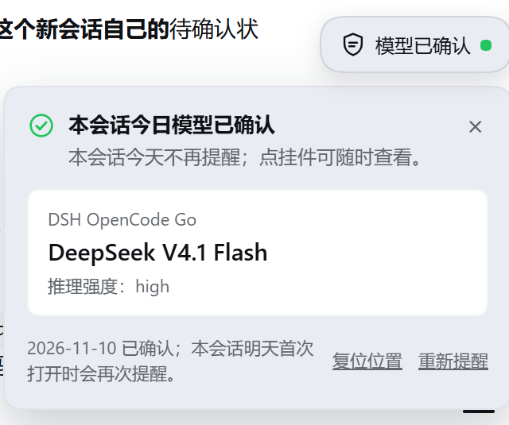

# dsh-model-reminder · 模型提醒挂件

> 每天、每个会话的第一次对话前，提醒你确认 DeepSeek Harness 当前选中的模型。
>
> [更新日志](CHANGELOG.md) · [MIT License](LICENSE)



## 特性

- **按会话提醒**：每个会话每天第一次打开时自动弹出面板，显示该会话下一条消息真正会用的提供方、模型和推理强度。A 会话确认过，不影响 B 会话；新建会话（还没发第一条消息）同样会出现。
- **确认即当天静音**：确认后当天同一会话不再提醒，次日自动重新提醒；页面跨零点也会重新提醒。
- **右上角悬浮挂件**：待确认时是琥珀色「模型待确认」，确认后变成绿色「模型已确认」，点击随时查看。
- **可拖动**：按住胶囊拖到任意位置松手即保存；方向键 10px、`Shift+方向键` 1px 微调；「复位位置」回到默认落点。
- **不打断输入**：面板朝向窗口内侧展开，窄窗口下也不会跑出屏幕。
- **零网络请求**：只在 Harness 本机路由上读写自己的 JSON 文件，不访问外部服务、不带凭据。
- **三语文案**：简体中文、English、日本語（界面文案与插件列表标题/描述）。

## 安装

当前只在本地/源码方式安装，没有发布到 npm。

### 从本地目录安装

在 Harness 的「插件 → 添加插件」里选择本地目录，指向本目录的绝对路径。

如果你在用 Agent，让它执行插件安装器：

```
plugin_manager  install_bundle  target=<绝对路径>\dsh-model-reminder
```

或者直接用 DSH CLI：

```bash
dsh plugin --profile desktop add link:<绝对路径>\dsh-model-reminder
```

安装成功后，「插件」页的已安装列表会出现「模型提醒挂件」，右上角挂件随即出现。

### 从 GitHub 克隆后安装

```bash
git clone https://github.com/<your-name>/dsh-model-reminder.git
cd dsh-model-reminder
dsh plugin --profile desktop add link:"$PWD"
```

### 修改后如何生效

- 改 `client.js`（浏览器半）：刷新 Harness 页面即可。
- 改 `index.js`（Host 半）：在插件页停用再启用 `include:dsh-model-reminder`，或重启 DSH。

## 使用

1. 打开一个会话，或点击「新建会话」。当天第一次进入时，面板会自动展开。
2. 核对面板里的模型；需要换模型就点输入框下方的模型选择器。
3. 点「确认，开始对话」——当天这个会话不再提醒。
4. 之后随时点胶囊查看当前模型；拖动胶囊或按方向键可以挪位置。
5. 已确认状态下，面板底部可以「重新提醒」或「复位位置」。

## 配置

`cordis.patch.yml` 的行 `config`：

| 键 | 类型 | 默认 | 说明 |
|---|---|---|---|
| `enabled` | boolean | `true` | `false` 时挂件完全不渲染 |
| `corner` | `top-right` \| `bottom-left` \| `bottom-right` | `top-right` | **没有保存位置时**的默认落点；拖动后以保存位置为准 |

修改配置后需要重载插件行（停用/启用）或重启 DSH。

## 工作原理

### Host 半 —— `index.js`

- `export const inject = ['connection']`，在 `apply` 里用 `ctx.connection.fetch.register` 注册三条路由（继承 Harness 的认证与同源校验，无需自建 HTTP 服务）。
- 模型解析顺序：会话的 `modelSelection` 投影（`next`，否则 `lastUsed`）→ 全局 `agentDefaultModel.currentSelection()`。
- 显示名通过 `ctx.llm.listProviders()` / `ctx.llm.listModels()` 解析，30 秒缓存，失败时回退为 provider/model ID。
- 两个 JSON 文件都在 `$DSH_HOME/dsh-model-reminder/` 下，写入用「临时文件 + rename」保证原子性。

### 浏览器半 —— `client.js`

单文件、无构建步骤：`window.__ModuleLoader__.load({ id, factory })` 注册一个浏览器模块。

| 关注点 | 做法 |
|---|---|
| 挂件位置 | `ctx.slots.register` 到帧级浮层 `shell.overlay`，`position: fixed` |
| 会话 id | 根作用域的浮层拿不到会话，所以在 `conversation.session.header.utilities` 和 `conversation.input.left` 各注册一个**零尺寸、返回 null** 的 reporter，把 `sessionId` 发布到模块内 store |
| 为什么两处 | 新建会话未发消息时头部是 `hideChrome` 状态，头座的 reporter 不挂载；输入栏座位仍然在，所以新会话也能拿到 id |
| 多座位合并 | `Map<seat, { id, seq }>` 取最新非空 id，任一座位卸载不会把另一个座位正在显示的会话清空 |
| 刷新 | 30 秒轮询 + 窗口 focus 时立即刷新 + 跨日检测 |
| 拖动 | `pointerdown/move/up`，移动超过 4px 才算拖拽；拖拽结束的 click 被抑制，不会误开面板 |
| 键盘 | 胶囊聚焦后方向键移动，500ms 防抖保存 |
| 定位 | 右半边按 `right` 锚定、下半部把面板翻到上方，保证面板朝窗口内侧 |
| 样式 | 全部走 `--dsw-alias-*` 主题令牌，跟随 Harness 明暗主题 |

### 数据文件

| 文件 | 内容 |
|---|---|
| `$DSH_HOME/dsh-model-reminder/ack.json` | `{ "sessions": { "<sessionId>": { "date": "YYYY-MM-DD", "at": 1794… } } }`，保留 7 天、最多 200 条 |
| `$DSH_HOME/dsh-model-reminder/position.json` | `{ "x": 1123, "y": 52 }`（视口像素）；删除即回到默认落点 |

## HTTP 接口

三条路由都挂在 Harness 的共享浏览器通道上，只接受同源、已认证的请求。

### `GET /api/model-reminder/state?session=<sessionId>`

```json
{
  "ok": true,
  "enabled": true,
  "corner": "top-right",
  "session": "session-…",
  "today": "2026-11-10",
  "ack": null,
  "pending": true,
  "selection": {
    "provider": "dsh-opencode-go",
    "model": "deepseek-v4.1-flash",
    "reasoningEffort": "high",
    "providerName": "DSH OpenCode Go",
    "modelName": "DeepSeek V4.1 Flash"
  }
}
```

### `POST /api/model-reminder/ack`

```json
{ "sessionId": "session-…", "date": "2026-11-10" }
```

重新提醒：`{ "sessionId": "session-…", "reset": true }`（等价于清掉该会话当天的确认）。

### `GET` / `POST /api/model-reminder/position`

`POST { "x": 1123, "y": 52 }` 保存；`POST { "reset": true }` 清除。

## 数据与隐私

- 只写本机 `$DSH_HOME/dsh-model-reminder/` 下的两个 JSON 文件。
- 不读取、不上传 API Key、账号信息、会话内容。
- 不发任何外部网络请求；模型名称来自 Harness 自己的 LLM 目录。

## 兼容性

- 在 DeepSeek Harness **0.2.2-rc.1**（Electron 44.7 / Web GUI）实测通过。
- 依赖的扩展点：`shell.overlay`、`conversation.session.header.utilities`、`conversation.input.left` 三个槽位，`ctx.connection.fetch`、`agentDefaultModel`、`llm`、`sessionProjections` 服务，以及 `dsh.client` 浏览器模块加载。
- 这些是 Harness 当前版本的公开扩展面，但 Harness 升级后仍可能调整；升级后若挂件消失，先看浏览器控制台与插件页的加载状态。

## 已知限制

- **没有发送前拦截**：Harness 的客户端事件只有连接、语言、槽位、主题四类，没有第三方可用的「发送前」钩子。提醒的时机是「该会话当天第一次打开 / 页面跨日」，并常驻在右上角，而不是按下发送键那一刻。
- **面板宽度固定 320px**：窄窗口下会向左覆盖内容；胶囊本身不会越出屏幕。
- 空白会话的「模型」来自默认选择（该会话还没有自己的选择记录）。

## 常见问题

**挂件不出现？**

1. 「插件」页确认「模型提醒挂件」的开关是开着的，且没有加载错误。
2. 刷新 Harness 页面（改过 `client.js` 后必须刷新）。
3. 打开 DevTools 控制台，过滤 `model-reminder` 看有没有异常。
4. 确认 `config.enabled` 不是 `false`。

**新建会话里没有？** 已修复：空白会话头部是 `hideChrome` 状态，插件在输入栏另有一个会话 reporter；如果仍不出现，刷新页面后再试。

**换了窗口位置不对？** 位置按视口像素保存，窗口变小时会自动夹回可视区；点「复位位置」回到配置的默认落点。

**怎么彻底卸载？** 插件页卸载 bundle，然后删除 `$DSH_HOME/dsh-model-reminder/` 目录（里面只有 `ack.json` 和 `position.json`）。

## 开发

无构建步骤，改完直接生效：

```bash
node --check index.js
node --check client.js
```

调试：

- 页面内直接访问 `/api/model-reminder/state?session=<id>` 查看 Host 返回。
- 浏览器控制台过滤 `dsh-model-reminder`（当前版本没有额外日志，出错会显示在面板的错误行）。
- 安装状态看「插件」页的 `dsh-model-reminder` 行；停用/启用即可重载 Host 半。

## 更新日志

见 [CHANGELOG.md](CHANGELOG.md)。

## 许可证

[MIT](LICENSE)。

## 致谢

挂件形态参考了 [dsh-whale-widget](https://github.com/MeteorNOX/DeepSeek-Balance-Whale-Widget) 的角落悬浮思路；项目的槽位与服务 API 参考资料来自 DeepSeek Harness 自带的 `cordis-plugin-development` 技能与已安装插件源码。
